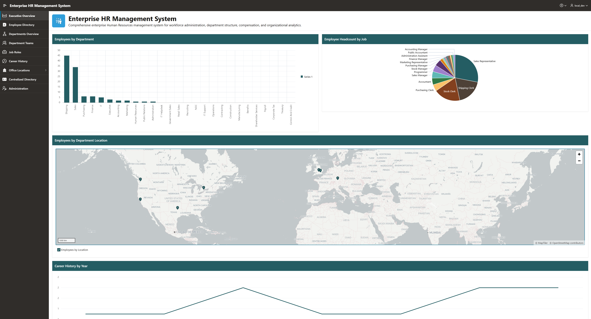

# Enterprise HR Management System

An Oracle APEX application for browsing and maintaining HR employee, department, job, career-history, and office-location data. The application source is maintained as APEXLang files.

## Capabilities

- Employee directory with department/job facets and text search.
- Department master–detail view with a department overview, office map, and responsive employee profile cards.
- Read-only employee detail page linked from directory records and department cards, with office map and role-protected compensation details.
- Employee, department, job, and office-location forms.
- Department, job, career-history, and centralized employee reports.
- Executive overview with headcount charts, career-history trend, location maps, and workforce reporting.
- Reader, Contributor, and Administrator access roles.
- Employee headcount analytics by department and job; employee salary and commission form fields are Administrator-only in the UI.
- Administration reports for APEX activity, errors, page usage, performance, and automation logs.
- Optional Progressive Web App push-notification subscription.

Compensation access needs a policy review before production: employee salary columns and employee salary/commission form items have Administrator-only UI authorization, while commission report columns and job salary ranges are not role-restricted in the current source. See [security operations](docs/technical/security-operations.md).

## Platform

- Oracle APEX 26.2-compatible application source; `.apex/apexlang.json` declares APEXLang model version `26.2.0+3479`.
- An Oracle Database schema containing the Oracle HR objects used by the application, including `EMPLOYEES`, `DEPARTMENTS`, `JOBS`, `JOB_HISTORY`, `LOCATIONS`, `COUNTRIES`, and `EMP_DETAILS_VIEW`.
- SQLcl/APEXLang tooling for application validation and import.

### HR sample schema compatibility

This application is designed for Oracle's sample `HR` schema. It uses the sample schema's employee, department, job, job history, location, and country objects, plus the `EMP_DETAILS_VIEW` view for the Centralized Directory. It is not a standalone HR database: the target schema must have these objects and the required grants before import. The application source does not create or seed them. Page reports, forms, and calculations also assume the column names and relationships in the sample schema; adapt those queries and components when using a customized or different HR schema.

This repository does not provision the database schema or include HR seed data. Confirm the target database objects and privileges before importing.

The current schema covers employee and organization master data. Leave, attendance, onboarding, recruiting, performance, benefits, and payroll workflows require separately approved data models and integrations; see [the product expansion plan](docs/technical/product-expansion-plan.md).

## Source layout

| Path | Purpose |
|---|---|
| `application.apx` | Application-level settings, authentication, authorization, navigation, and PWA configuration |
| `pages/` | Page definitions, reports, forms, charts, maps, and administration tools |
| `shared-components/` | Shared authorization schemes, roles, LOVs, navigation, theme, and build options |
| `workspace-components/` | Workspace credential references and the Gemini service definition; secret values belong in the target workspace |
| `deployments/` | Local deployment metadata; excluded from Git |
| `apex-exports/` | Optional SQL export snapshots created as pre-import backups; SQL Developer Extension settings control whether they are created, how many are retained, and where they are stored. APEXLang files remain the maintained source. |
| `docs/` | Client handover and technical documentation |

## Validate and deploy

Run validation from SQLcl with the APEXLang 26.2 tooling:

```text
apex validate -input "<path-to-enterprise-hr-management-system>"
```

For deployment, connect SQLcl to the target database and import the application directory:

```text
apex import -input "<path-to-enterprise-hr-management-system>"
```

Import into a non-production environment first. Use the deployment runbook for target prerequisites, credentials, access-control setup, and post-import checks. Do not place database passwords or environment-specific values in this README, source control, or shell history.

## Documentation

The APEXLang definitions under `pages/`, `shared-components/`, and `application.apx` are authoritative. These documents describe the source as inspected; target-environment behavior still requires deployment validation.

### Client delivery

- [Client handover](docs/client-delivery/handover.md)
- [End-user guide](docs/client-delivery/user-guide.md)

### Technical reference

- [Architecture and page catalog](docs/technical/architecture.md)
- [Application design system](docs/technical/design-system.md)
- [Data model and report semantics](docs/technical/data-model.md)
- [Deployment runbook](docs/technical/deployment-runbook.md)
- [Security and operations](docs/technical/security-operations.md)
- [Acceptance checklist](docs/technical/acceptance-checklist.md)
- [Product expansion plan](docs/technical/product-expansion-plan.md)
- [Copyright notice and author profiles](docs/COPYRIGHT.md)
- [Contribution guidance](CONTRIBUTING.md)

### Screen captures

The [end-user guide](docs/client-delivery/user-guide.md) includes screenshots beside the relevant workflows. Original captures are stored in `docs/medias/`:



*Executive Overview — workforce analytics and job history.*

| File | Screen |
|---|---|
| [`p1.png`](docs/medias/p1.png) | Executive Overview |
| [`p2.png`](docs/medias/p2.png) | Employee Directory |
| [`p4.png`](docs/medias/p4.png) | Departments Overview and employee hierarchy |
| [`p11.png`](docs/medias/p11.png) | Department Teams, office map, and employee cards |
| [`p13.png`](docs/medias/p13.png) | Employee Details and office map |
| [`p13-1.png`](docs/medias/p13-1.png) | Employee edit drawer opened from Employee Details |

© 2026 Mamadou Moussa Balde. Author profiles: [LinkedIn](https://www.linkedin.com/in/2mb/) · [GitHub](https://github.com/baldemoussa). See the [copyright notice](docs/COPYRIGHT.md).

## GitHub and distribution

The documentation is prepared for a GitHub repository, but this workspace has no Git repository or remote configured, so nothing has been published. No license has been supplied; select and approve a license before public distribution. Review all source and history for environment-specific data before pushing.
