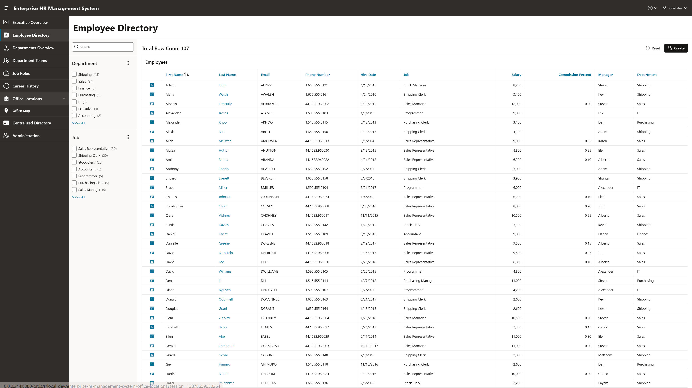
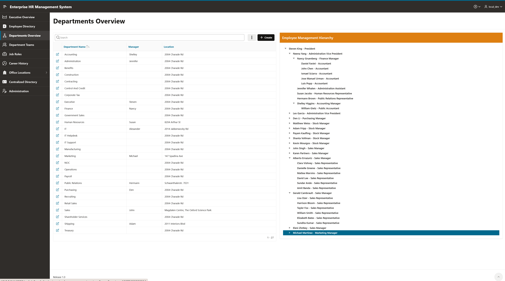
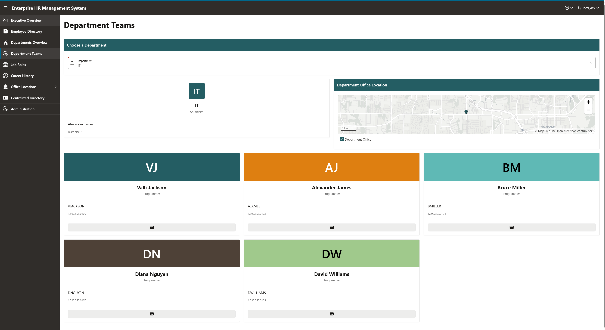
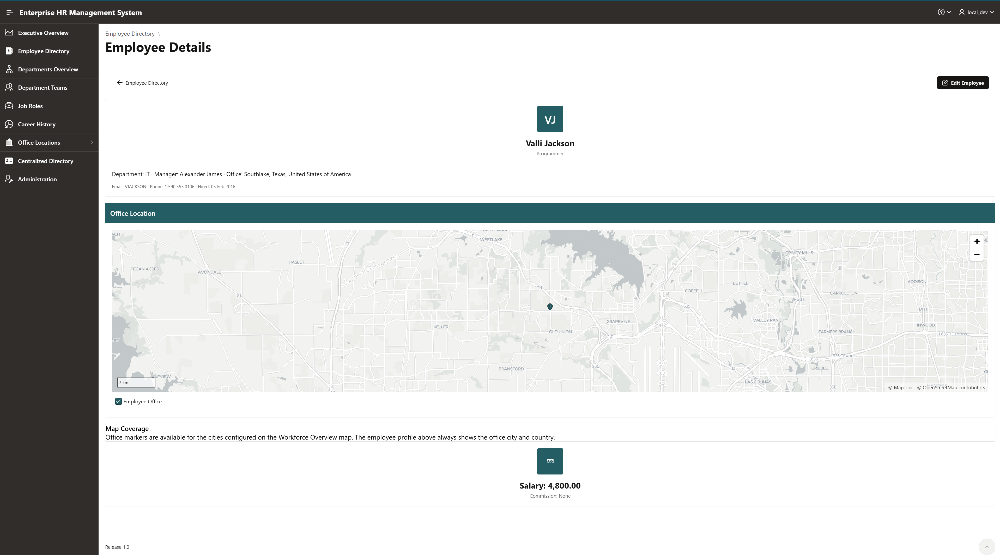
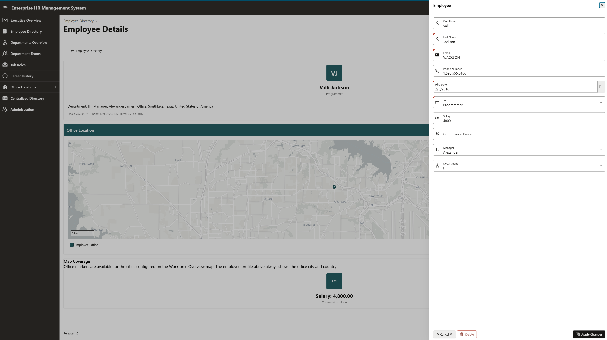
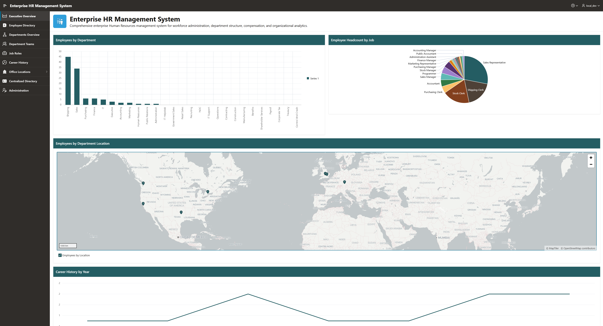

# End-User Guide

## Sign in and access levels

Sign in with an Oracle APEX account provisioned for the application. Access is assigned through the application's access-control list.

| Role | Capabilities |
|---|---|
| Reader | View HR information and reports |
| Contributor | Reader capabilities plus create, edit, and delete operations on supported HR forms |
| Administrator | Contributor capabilities plus application access and administration tools |

An Administrator provisions an application ACL entry and role. With Oracle APEX Accounts authentication, the user must also exist as a workspace end user; a workspace administrator manages that account and its password.

## Find and maintain employee records

1. Open **Employee Directory** from the navigation menu.
2. Enter a search term or narrow results using the Department and Job facets.
3. Use **Reset** to clear the active search and facets.
4. Select an employee's profile icon to open **Employee Details**. The detail page shows the employee's role, department, manager, contact information, hire date, and office map.
5. Contributors can select **Edit Employee** from the detail page; Readers can inspect the profile without changing data. Use **Employee Directory** to return to the report.
6. On **Department Teams**, the office map appears beside the department overview. Changing the department refreshes its overview, map, and employee cards. Select the profile icon at the bottom of an employee card to open the employee detail page; the employee name remains plain text.
7. Save or cancel changes in the employee form. Database constraints may prevent deleting an employee that is referenced by other HR records.

View the Employee Directory screen

The directory displays employee, department, job, manager, and contact details. The `Salary` column and the detail-page compensation card are visible only to Administrators. The `Commission Percent` column is currently visible to users with report access. Treat all employee data as confidential.

## Browse organization and office information

- **Departments Overview** lists departments; Contributors can open the department form to maintain supported fields.
- **Departments Overview** also shows the employee reporting hierarchy beside the department report. Expand or collapse manager nodes to follow the employee-to-manager structure.
- **Department Teams** lets you choose a department, view its office, manager, and team size, then browse employees as profile cards with job title and contact details.
- **Employee Details** is opened from the profile icon in Employee Directory or on a Department Teams card. It is a read-only profile page with an office map; Contributors and Administrators can open the existing employee form using **Edit Employee**.
- **Job Roles** lists job definitions; Contributors can open a job form.
- **Office Locations** lists locations; Contributors can open a location form.
- **Career History** displays job-history records.
- **Centralized Directory** searches the combined employee details view.

Interactive reports provide standard APEX sorting, filtering, and report actions where enabled.

View Departments Overview and employee hierarchy

View Department Teams

View Employee Details and office map

View the Employee edit drawer

The Job Roles report includes minimum and maximum job salary ranges. These values are not restricted by role in the current source. Follow your organization's approved data access policy and contact an Administrator if this needs to change.

## View charts and maps

- **Executive Overview** contains employee counts by department and job, employee counts by known office location, and a line chart counting career-history records by their start year. The career-history line counts records; it does not measure retention or employee transfers.
- **Office Map** shades country polygons by employee count for countries currently represented in the map data. Hover over a country for its employee count.

View Executive Overview

## Settings and help

- Open **Settings** to view user settings.
- **Push Notifications** lets each supported device subscribe or unsubscribe. The browser will ask for notification permission; permission and subscription are device-specific.
- Use the in-application Help action for page-specific guidance. The About page describes the application's supported scope.

## Administrator tools

Administrators can open **Administration** to configure access scope, manage users and roles, and review activity, error, page-view, performance, and automation logs. These reports may contain usernames and operational details; share them only with authorized support staff.
