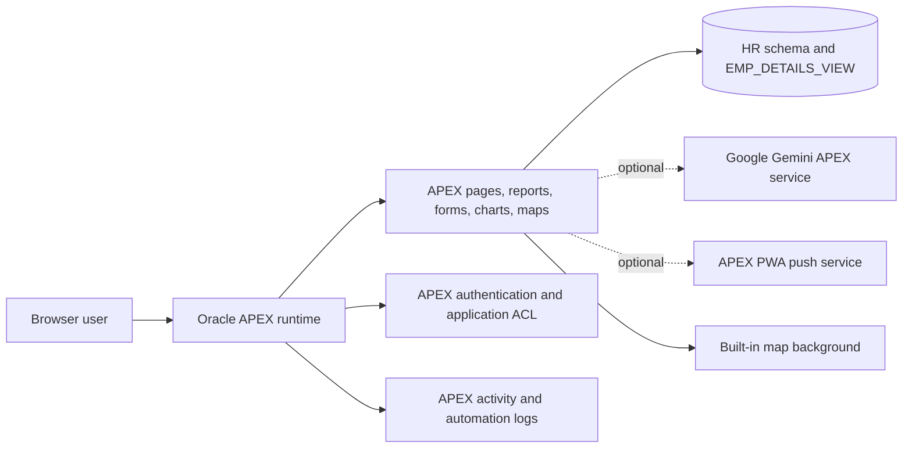

# Architecture and Page Catalog

## Overview

This is a declarative Oracle APEX application. APEXLang page and shared-component files define the UI, SQL-backed reports and charts, forms, authorization, navigation, and optional platform integrations. The application runs in Oracle APEX and reads or writes an existing Oracle HR schema; no application server or separate REST API is defined in this source tree.

The Gemini definition is referenced at application level and has a workspace Web Credential dependency. Push notifications are an enabled PWA capability with a separate Web Credential reference. Provision and verify these integrations in the target workspace; this source does not contain their secret values.

## Application structure

| Path | Responsibility |
|---|---|
| `application.apx` | App name, home/login pages, APEX Accounts authentication, reader authorization, theme, PWA, and app settings |
| `pages/` | Individual page, region, form, report, and component definitions |
| `shared-components/` | ACL roles and schemes, navigation, breadcrumbs, LOVs, theme, and build options |
| `workspace-components/` | Gemini service and workspace credential references |
| `deployments/` | Environment-specific deployment metadata; keep it out of public source control |
| `apex-exports/` | Generated SQL backups created before imports |

## Page catalog

| Page | Name | Purpose |
|---:|---|---|
| 0 | Global Page | Shared application chrome and global components |
| 1 | Executive Overview | Employee counts by department and job, employee counts by known office location, and `JOB_HISTORY` record count by start year |
| 2 | Employee Directory | Employee report with search, Department and Job facets, employee-detail links, and create entry point |
| 3 | Employee | Employee create/update/delete form, opened from Employee Details for authorized contributors |
| 4 | Departments Overview | Department interactive report beside an expandable employee reporting tree built from `EMPLOYEES.EMPLOYEE_ID` and `EMPLOYEES.MANAGER_ID` |
| 5 | Department | Department create/update/delete form |
| 6 | Job Roles | Job interactive report |
| 7 | Job | Job create/update/delete form |
| 8 | Career History | Job-history interactive report |
| 9 | Office Locations | Location interactive report |
| 10 | Location | Location create/update/delete form |
| 11 | Department Teams | Department selector, office/manager/team-size overview card beside a mapped office location, and paginated three-column employee cards; changing department refreshes the overview, map, and team |
| 12 | Centralized Directory | Searchable report over `EMP_DETAILS_VIEW` |
| 13 | Employee Details | Read-only employee profile and office map; Administrator-only compensation card; Contributor/Administrator edit action opens Page 3 |
| 15 | Office Map | Country polygons shaded by employee counts |
| 9999 | Login Page | Oracle APEX authentication entry page |
| 10000 | Administration | Administration landing page and ACL role counts |
| 10010 | Activity Dashboard | Recent activity, top users, active pages, and recent errors |
| 10011 | Top Users | User activity report/chart |
| 10012 | Application Error Log | APEX application error report |
| 10013 | Page Performance | APEX page elapsed-time and usage report |
| 10014 | Page Views | Recent page-view report |
| 10015 | Automations Log | APEX automation execution report |
| 10016 | Log Messages | Messages for a selected automation execution |
| 10020 | Configure Access Control | Set whether authenticated users outside the ACL may use the app |
| 10021 | Manage User Access | List application users and assigned roles |
| 10022 | Manage User Access | Add, edit, or delete an ACL user and roles |
| 10023–10024 | Add Multiple Users | Bulk ACL-user entry and review flow |
| 10030 | About | Application scope and support guidance |
| 10031 | Help | Displays current page help text |
| 20000 | Settings | User settings drawer |
| 20010 | Push Notifications | Device push subscription controls |

## Authorization

Shared schemes are defined in `shared-components/authorizations.apx`:

- `reader-rights` is the application-level access scheme. The default `ACCESS_CONTROL_SCOPE` is `ACL_ONLY`; in that mode, a user needs an application ACL role. The optional `ALL_USERS` setting admits authenticated users who are not listed in the ACL.
- `contribution-rights` permits Administrators and Contributors to use protected editing actions.
- `administration-rights` restricts administration pages to the Administrator role.

Page 13 is available to users with page access. Employee Directory names and profile icons and Department Teams cards pass the selected `EMPLOYEE_ID` to the detail page. The detail page does not perform DML; employee changes still use the Page 3 form and its contribution-rights authorization. Salary and commission are selected in a separate Administrator-authorized region.

Role descriptions and enforcement details are in the [security and operations guide](security-operations.md).

Screen captures of the major user-facing pages are embedded in the [end-user guide](../client-delivery/user-guide.md) and indexed from the [project README](../../README.md).

The application uses the Iris Universal Theme style. Page 1 visualizations and the Department Teams selector use the shared accent; navigation and form actions use Font APEX icons. See the [design system](design-system.md) for the styling and icon conventions.

The Global Page displays the copyright notice across the application. See the [project copyright notice](../COPYRIGHT.md) for scope and third-party license boundaries.
