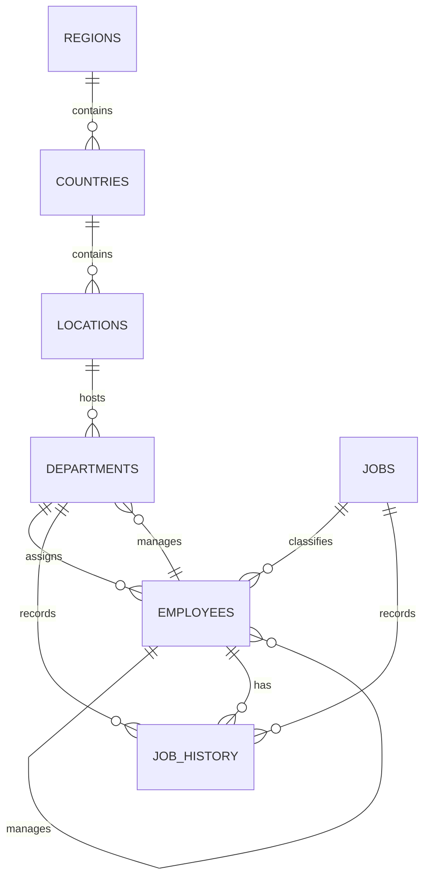

# Data Model and Report Semantics

## Database boundary

The application expects an Oracle HR schema to be present in the target database. No DDL, migrations, or seed data are included in this project. The exact object definitions and constraints must be checked against the client's schema before import.

The application directly references these data objects:

| Object | Use in the application |
|---|---|
| `EMPLOYEES` | Employee directory/form, employee detail, department/job counts, location counts, Department Teams detail cards |
| `DEPARTMENTS` | Department report/form, Department Teams master card, employee-to-office mapping and employee detail office resolution |
| `JOBS` | Job report/form (including `MIN_SALARY` and `MAX_SALARY`), employee-to-job classification, employee card job titles |
| `JOB_HISTORY` | Career History report and Page 1 history-count trend |
| `LOCATIONS` | Office report/form and map aggregation |
| `COUNTRIES` | Country names and location-country grouping |
| `EMP_DETAILS_VIEW` | Combined employee, job, department, location, country, and region directory |
| `REGIONS` | Referenced through the combined details view |

The HR tables are expected to follow the conventional relationships below. Confirm actual keys and nullability in the target schema.

`EMP_DETAILS_VIEW` is a read-oriented combined view used by the Centralized Directory; it is not a replacement for the base HR tables used by the forms.

## Data access patterns

- Pages 2–10 use native APEX reports and forms over the HR tables. The employee, department, job, and location forms write directly to their respective tables through APEX form processing.
- Page 1 uses SQL queries for department/job headcount, office counts, and job-history record counts by start year.
- Page 11 uses a bound department selector to read a department overview, office location map, and employee cards; it does not write HR data. The map plots the selected department's location for cities in the shared coordinate lookup.
- Page 13 reads one employee by the passed `P13_EMPLOYEE_ID`, joins the employee to job, department, manager, location, and country for the read-only profile, and plots the department office for supported cities. Its compensation region is separately authorized for Administrators.
- Page 15 uses SQL to aggregate employee counts for its country map.
- Page 12 reads the database view `EMP_DETAILS_VIEW`.
- Administration reports read APEX activity, automation, and ACL views/tables.
- The application does not include a separate application API or data-migration layer.

## Reporting definitions and caveats

| Screen/region | Current query semantics |
|---|---|
| Home — Employees by Department | `COUNT(EMPLOYEE_ID)` grouped by department, including empty departments |
| Home — Employee Headcount by Job | `COUNT(EMPLOYEE_ID)` grouped by job, including unfilled jobs |
| Home — Career History by Year | Counts `JOB_HISTORY` rows grouped by the year of `START_DATE`; this is a count of recorded job-history entries, not employee transfers or retention |
| Home — Employees by Department Location | Counts employees under departments grouped by `DEPARTMENTS.LOCATION_ID`; the map only plots cities in its hard-coded coordinate lookup |
| Department Teams — Overview | Reads selected department, office city, manager, and employee count |
| Department Teams — Office Location | Reads the selected department location and maps recognized office cities with the Home page coordinate lookup |
| Department Teams — Team Members | Reads employees assigned to the selected department; displays name, job title, email, and phone |
| Employee Details — Employee Profile | Reads one employee by primary key and displays job, department, manager, contact details, hire date, and office |
| Employee Details — Office Location | Resolves the employee's department location and plots it from the same static city coordinate set used on Home; unmapped cities have no marker |
| Employee Details — Compensation | Reads salary and commission for the selected employee in an Administrator-authorized region |
| Office Map | Counts employees by office country, joins to the country name and a static polygon boundary, and omits countries with no employees |
| Centralized Directory | Search fields are provided by `EMP_DETAILS_VIEW` |

The Home, Department Teams, and Employee Details office maps exclude cities without a coordinate entry. Keep the city lookup expressions synchronized when new office cities are added; the department and employee profiles still show office city text when a map marker is unavailable. The Office Map currently contains generalized Natural Earth polygons for the United States, Canada, United Kingdom, and Germany. New countries require a corresponding boundary entry in the page source. The map geometry is for visualization, not precision measurement.

## Sensitive data

Employee names, contact details, job details, salary, and commission are personal or confidential business data. Employee `SALARY` report columns, the Page 13 compensation card, and the employee form's `SALARY` and `COMMISSION_PCT` items are Administrator-only in the APEX UI. However, `COMMISSION_PCT` report columns and `JOBS.MIN_SALARY`/`MAX_SALARY` report/form fields are not role-restricted in the current source. Review these fields with the data owner before production. Any APEX UI control must be backed by database grants, views, exports, and downstream integration controls. Use synthetic or approved masked data in development and acceptance environments.

## Functional scope boundary

The supplied schema supports organization and employee master data only. It has no leave balances/requests, timesheets, onboarding tasks, candidate/requisition records, review cycles, benefits, or payroll processing. Those workflows must not be implemented against unrelated HR columns. Before adding them, approve the schema and ownership/integration boundaries in [the product expansion plan](product-expansion-plan.md); provision the required tables and constraints through the client's database change process, then add pages and workflows against those objects.
